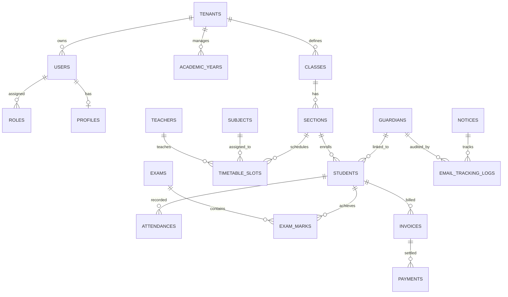

# Project Technical Proposal: Next-Generation School Management SaaS Platform (SMS)

**Project Title:** Development of a World-Class, 100% Web-Based School Management SaaS Platform  
**Client / Stakeholder:** Aniket  
**Engineering Team:** Antigravity Development Team  
**Date:** September 20, 2026  
**Document Version:** 1.0.0-FINAL  
**Deployment Profile:** 100% Web-Based SaaS (Vercel Edge + Multi-Tenant Cloud Architecture)

---

## 1. Executive Summary & Vision

This document details the architectural blueprint, module specifications, development roadmap, and commercial estimates for building a **world-class, 100% web-based School Management SaaS Platform**. 

The system is engineered to eliminate any hardware or on-premise device overhead. It delivers a blazing-fast, desktop-quality experience directly inside the browser using modern web standards: **React on Vercel Edge**, **Multi-Tenant Laravel 11**, **PostgreSQL**, **Redis**, and **WebSockets**.

Key differentiators include:
- **Zero Hardware Footprint:** Pure web ecosystem with full PWA installation capability on iOS, Android, and Desktop.
- **Strict Multi-Tenancy:** Hardened tenant isolation (database/schema per school) ensuring absolute data privacy and compliance.
- **Hyper-Responsive UX:** Drag-and-drop routine builders, skeleton loading states, sub-50ms spotlight search (`Ctrl + K`), and fluid micro-interactions.
- **Automated Intelligence:** Pixel-perfect PDF grade cards, automated fine & fee invoicing, real-time push synchronization, email read-tracking analytics, and a contextual AI support assistant.

---

## 2. Technical Stack & Architectural Architecture

### 2.1 Technology Stack Matrix

| Layer | Recommended Technology | Technical Rationale |
|---|---|---|
| **Frontend Framework** | **React 19 / Next.js (App Router) on Vercel** | Global Edge CDN caching, instantaneous routing, SEO readiness for public school portals, sub-50ms TTFB. |
| **Design System & Styling** | **Tailored Vanilla Design Tokens + Radix UI + Framer Motion** | Zero CSS runtime bloat, seamless dark/light theme switching, strict WCAG 2.1 AA accessibility, fluid micro-interactions. |
| **Backend Core** | **Laravel 11 (PHP 8.3+)** | Enterprise-grade ORM (Eloquent), robust queuing, first-class multi-tenancy ecosystem, built-in security middleware. |
| **Multi-Tenancy Engine** | **`stancl/tenancy`** | Automatic tenant scoping, custom domain mapping (`portal.schoolname.com`), isolated database/schema per tenant. |
| **Database** | **PostgreSQL 16** | Native JSONB indexing for flexible custom grading schemes, high concurrency, partitioned audit logs, point-in-time recovery. |
| **Real-time Engine** | **Laravel Reverb / WebSockets** | Sub-100ms real-time event streaming without costly third-party message quotas. |
| **Cache & Queue Broker** | **Redis 7.x** | High-throughput background workers for PDF generation, bulk invoicing, and email analytics ingestion. |
| **Document Engine** | **Headless Chromium (Browsershot / Puppeteer)** | Pixel-perfect print-ready PDF generation with custom school watermarks and dynamic QR codes. |
| **AI Engine** | **Google Gemini Flash / OpenAI API** | Lightweight RAG pipeline for school handbook queries, admission FAQs, and automated parent assistance. |

---

## 3. System Architecture Diagram

```
[ Web Browsers & Mobile PWA ]
              │ (HTTPS / WSS)
              ▼
[ Vercel Edge CDN ] ──── (Static Assets & React Shells Cached Globally)
              │
              ▼ (JSON:API / REST)
[ Application Gateway & Load Balancer ]
              │
     ┌────────┴──────────────────────────┐
     ▼                                   ▼
[ Laravel 11 Multi-Tenant Core ]    [ Laravel Reverb WebSocket Cluster ]
  • Tenant Resolver (Subdomain)       • Real-Time Mark Alerts
  • RBAC & Security Middleware        • Live Attendance Pushes
  • Business Logic Services           • Direct Chat Streams
     │               │
     ├───────────────┼──────────────────────────┐
     ▼               ▼                          ▼
[ Redis Cluster ]  [ PostgreSQL 16 ]     [ Worker Node (Queues) ]
  • Cache Stores     • Tenant Schemas       • PDF Report Card Rendering
  • BullMQ Queues    • JSONB Gradebooks     • Bulk Fee Invoice Dispatch
  • Session Sync     • Audit Logs           • Email Tracking Ingestion
```

---

## 4. Deep-Dive Feature Specifications

### 4.1 Granular Role-Based Access Control (RBAC)
The platform isolates interfaces and permissions into five dedicated role portals:
1. **Super Admin (Platform Owner):** Multi-school onboarding, billing subscriptions, global usage telemetry, tenant migrations.
2. **School Administrator / Principal:** Institutional policies, academic sessions, staff assignment, role permissions, audit trails.
3. **Teachers:** Class rosters, visual attendance registers, gradebook entry with real-time autosave, syllabus tracking, parent messaging.
4. **Students:** Today's routine, upcoming exam schedules, syllabus progression, digital report card downloads, fee payment receipts.
5. **Parents:** Unified multi-ward selector, tuition fee payments, real-time absence alerts, live grade notifications, direct teacher chat.
6. **Accountants:** Fee structure configurations, overdue fine tiers, payment gateway reconciliation, expense ledgers.

### 4.2 Academic & Examination Engine
- **Visual Routine Builder:** Drag-and-drop interactive timetable grid with instantaneous conflict detection (preventing teacher or classroom double-booking).
- **Dynamic Syllabus Tracker:** Tree structure tracking Units -> Topics -> Status (Not Started, In Progress, Completed) with progress percentages visible to parents and admins.
- **Flexible Exam Grading:** Supports GPA (4.0/5.0), CGPA, percentage, and letter grading curves. Continuous assessment weighting (e.g., 30% Midterms + 70% Finals).
- **Automated High-Fidelity PDF Report Cards:** Serverless/queue-driven headless Chrome engine rendering print-ready grade sheets featuring student photographs, grade breakdowns, attendance summaries, teacher comments, and verifiable QR codes.

### 4.3 Finance, Billing & Payment Processing
- **Automated Recurring Invoices:** Scheduled generation of term fees, tuition, transportation, and laboratory dues.
- **Configurable Fine Engine:** Automated progressive late fines based on overdue grace periods.
- **Universal Payment Gateway Integration:** Native webhooks for Stripe, PayPal, Razorpay, SSLCommerz, and local banking gateways, alongside manual bank deposit slip verification workflows.
- **Automated Receipts:** Immediate digital PDF receipt delivery to parent email and in-app finance ledger.

### 4.4 Communication & Advanced Tracking Engine
- **Direct Messaging:** Secure, real-time chat between parents and verified subject teachers with anti-spam messaging windows.
- **Dynamic Notice Board:** Filtered notice dispatches with attachment support (PDF/Images) and real-time push alerts.
- **Proprietary Email Tracking System:**
  - Automated injection of a unique cryptographic `1x1.png` tracking pixel in sent emails.
  - Link wrapping mechanism to record click-through activity.
  - Interactive Admin analytics dashboard showing parent read status, delivery times, and unread follow-up triggers.

### 4.5 Advanced Web Features
- **Spotlight Search (`Ctrl + K` / `Cmd + K`):** Global command bar allowing instant indexing across students, teachers, classes, invoices, and actions.
- **PWA (Progressive Web App):** Installable directly from Chrome/Safari to home screens. Implements Service Workers with Stale-While-Revalidate caching for instant offline timetable access.
- **Context-Aware AI Chat Assistant:** 24/7 web assistant trained on the school's handbook and public schedule to answer parent queries regarding fees, events, and admissions.

---

## 5. Database Schema & Entity Relationships



---

## 6. Sprint Roadmap & Implementation Milestones (16-Week Agile Plan)

```
[ Week 1-2 ]   Sprint 0: Discovery, Figma Design System & Architecture Approval
[ Week 3-4 ]   Sprint 1: Multi-Tenancy Core, PostgreSQL Schema & RBAC Authentication
[ Week 5-6 ]   Sprint 2: Academic Management, Visual Drag & Drop Routine Builder
[ Week 7-8 ]   Sprint 3: Examination, Grading Engine & Automated PDF Report Generator
[ Week 9-10]   Sprint 4: Finance & Invoicing Engine, Penalty Automation, Payment Gateways
[ Week 11-12]  Sprint 5: Communication Engine, Laravel Reverb WebSockets & Email Read Tracker
[ Week 13-14]  Sprint 6: Spotlight Search (Ctrl+K), PWA Offline Capabilities & AI Chatbot
[ Week 15-16]  Sprint 7: Security Penetration Audit, Load Testing, Final Production Launch
```

### Detailed Sprint Breakdown

#### Sprint 0: UI/UX Design System & System Architecture (Weeks 1 - 2)
- Production of complete Figma Design System (Color tokens, Dark/Light modes, typography, button/card primitives).
- High-fidelity interactive prototypes for Super Admin, Teacher, Student, Parent, and Accountant dashboards.
- Database ERD and API route contract sign-off.

#### Sprint 1: Multi-Tenancy Core & Authentication (Weeks 3 - 4)
- Multi-tenant routing (`subdomain.domain.com` and custom domain mapping via `stancl/tenancy`).
- Dynamic PostgreSQL tenant schema creation.
- Laravel Sanctum / JWT authentication with role-based permission policies.
- Account profile management and password reset flows.

#### Sprint 2: Academic Structure & Routine Builder (Weeks 5 - 6)
- Academic session, class, section, and subject cataloging.
- Drag-and-drop timetable scheduler with real-time teacher and room collision detection.
- Syllabus milestone tracker with teacher completion logging.

#### Sprint 3: Examination & Automated PDF Report Cards (Weeks 7 - 8)
- Exam scheduling and multi-scheme gradebook (GPA, CGPA, Percentage, Letter grades).
- Batch mark entry interface with real-time validation and calculation.
- Queue-based automated generation of pixel-perfect, watermarked, QR-coded PDF report cards.

#### Sprint 4: Finance, Billing & Payment Gateway (Weeks 9 - 10)
- Automated fee invoice generation by grade and category.
- Late fine rule engine with automatic calculation.
- Integration with international and regional payment gateways (Stripe, PayPal, Razorpay, etc.).
- Automated digital receipt generation and payment ledger.

#### Sprint 5: Communication & Email Read-Receipt Engine (Weeks 11 - 12)
- Real-time notification dispatch via Laravel Reverb WebSockets.
- In-app parent-teacher messaging with conversation threads.
- Filtered notice board system.
- Email tracking pipeline with 1x1 transparent tracking pixel injection, click tracking, and admin analytics dashboard.

#### Sprint 6: Advanced Web Features (Spotlight, PWA & AI) (Weeks 13 - 14)
- Global `Ctrl + K` spotlight search with keyboard navigation.
- Progressive Web App (PWA) manifest and Workbox service worker caching for offline timetable review.
- Contextual AI chatbot integration for instant parent query resolution.

#### Sprint 7: Hardening, Load Testing & Deployment (Weeks 15 - 16)
- OWASP Top 10 security penetration review and data isolation testing.
- Load testing (simulating 10,000 concurrent active users).
- Production deployment of React frontend on Vercel Edge and Laravel backend on managed cloud servers.
- Final user acceptance testing (UAT) and handover.

---

## 7. Development Cost & Resource Allocation

### 7.1 Engineering Resource Commitment
- **Lead Solutions Architect** (25% allocation throughout project)
- **Senior Full-Stack Engineer (Backend / Laravel Lead)** (100% allocation)
- **Senior Frontend Engineer (React / Next.js / PWA Lead)** (100% allocation)
- **UI/UX Designer** (50% allocation across Sprints 0 - 3)
- **QA Automation Engineer** (50% allocation across Sprints 3 - 7)
- **DevOps / Cloud Specialist** (25% allocation)

### 7.2 Milestone-Based Commercial Pricing

| Milestone | Deliverables & Scope | Estimated Hours | Milestone Fee (USD) |
|---|---|---|---|
| **Milestone 1** | Complete Figma Design System & Architecture Document | 80 hrs | $4,500 |
| **Milestone 2** | Multi-Tenancy Core, PostgreSQL Schema & RBAC Portals | 160 hrs | $8,500 |
| **Milestone 3** | Academic Engine, Drag-and-Drop Routine & PDF Report Cards | 200 hrs | $11,500 |
| **Milestone 4** | Finance, Invoicing Automation & Payment Gateways | 160 hrs | $9,000 |
| **Milestone 5** | Real-time WebSockets, Messaging & Email Read Tracker | 160 hrs | $9,500 |
| **Milestone 6** | Spotlight Search, PWA, AI Chatbot, QA & Production Launch | 120 hrs | $7,000 |
| **Total Project** | **End-to-End Turnkey Delivery (16 Weeks)** | **880 hrs** | **$50,000** |

---

## 8. Ongoing Cloud Infrastructure Operating Costs (Estimate)

| Component | Recommended Service | Estimated Monthly Cost |
|---|---|---|
| **Frontend Delivery** | Vercel Pro | $20 / team member / mo |
| **Backend & Database** | AWS / DigitalOcean Managed PostgreSQL & App Server | $80 - $250 / mo |
| **WebSockets & Real-time** | Laravel Reverb (Self-Hosted) or Pusher | $20 - $49 / mo |
| **File Storage & CDN** | Cloudflare R2 / AWS S3 | $15 - $30 / mo |
| **Transactional Email & Tracking** | SendGrid / Postmark | $30 - $75 / mo |
| **AI API Consumption** | Google Gemini Flash / OpenAI | $20 - $50 / mo |

---

## 9. Next Steps

1. **Review & Approval:** Review this technical proposal and milestone schedule.
2. **Kickoff Sprint 0:** Initiate the Figma UI/UX design phase and finalize the initial design tokens and wireframes for your review.
